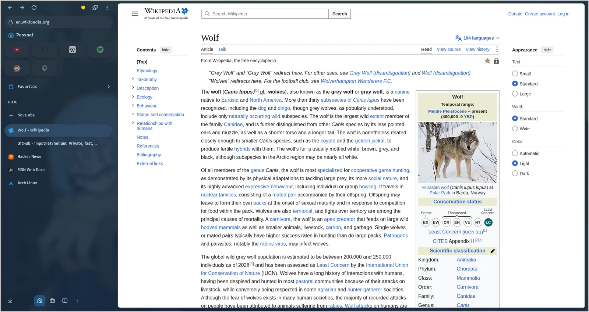
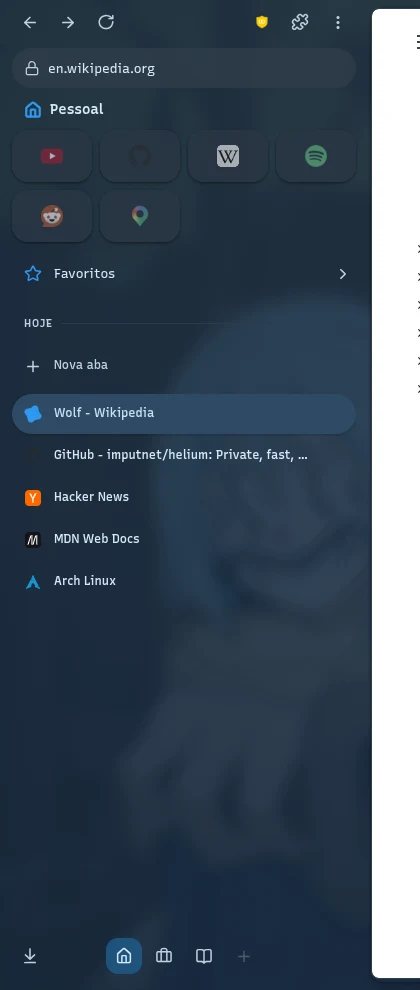
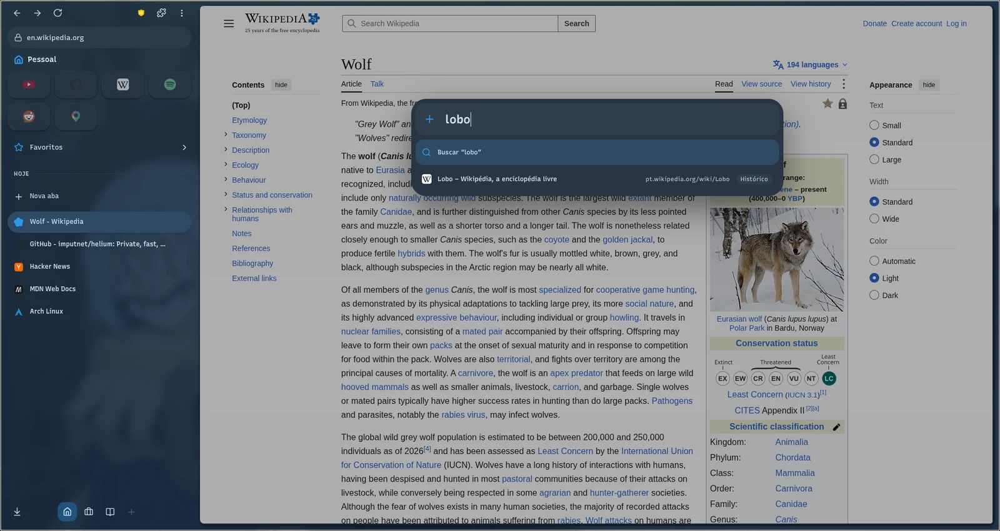
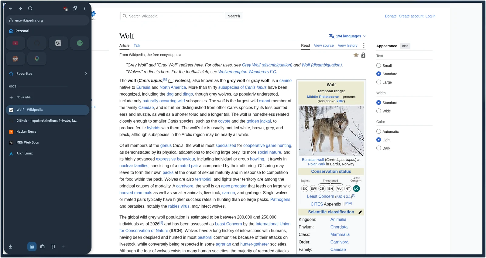
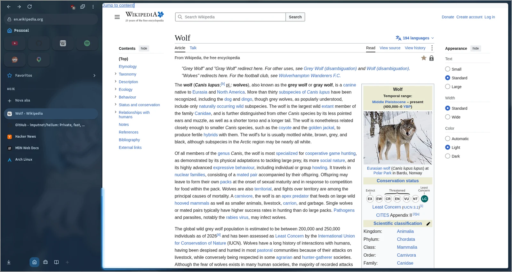
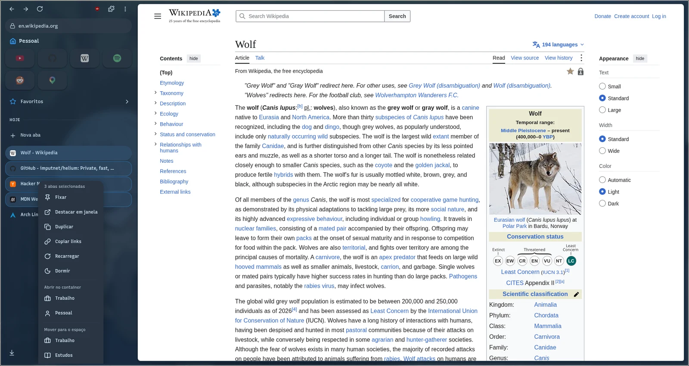
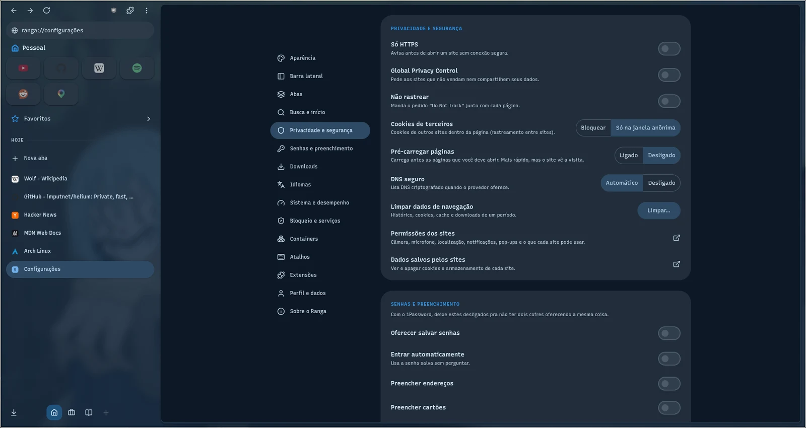

<div align="center">


# Ranga

**Um navegador pessoal pra Linux, com barra lateral, espaços e cara de desktop.**

Feito sobre o [Helium](https://github.com/imputnet/helium) (Chromium sem Google), com a barra lateral no estilo do Arc, Material 3 e as cores do tema do sistema.




</div>

> [!NOTE]
> O Ranga ainda está em desenvolvimento (0.x). Uso diário, mas pensado pra minha máquina (Omarchy + Hyprland); em outro Linux deve funcionar, sem garantia.

## Por que o Ranga

O Chromium guarda abas numa faixa no topo, configurações em dois lugares e trata a janela como moldura. O Ranga troca isso por uma barra lateral que organiza o dia: **espaços** pra separar trabalho e vida, **fixadas** pros sites de sempre, **hoje** pras abas que vêm e vão (e que se arquivam sozinhas). A página vira um cartão e o resto sai do caminho.

<table>
<tr>
<td width="33%" valign="top"></td>
<td valign="top">

### A barra lateral

- **Espaços** com ícone, cor e container próprios. Ctrl+Shift+← / → ou rolar de lado troca de espaço; cada um lembra a última aba.
- **Fixadas** em grade de cartões, com pastas. Um link aberto de uma fixada aparece num **Peek** por cima da página.
- **Hoje**: as abas do dia. Paradas dormem e as esquecidas são arquivadas, com Desfazer.
- **Favoritos**, downloads com anel de progresso, extensões fixadas e o endereço da aba atual.
- Renomear abas com duplo clique, Ctrl/Shift+clique pra marcar várias e fechar, mover ou fixar todas de uma vez.

</td>
</tr>
</table>

## Destaques

<table>
<tr>
<td width="50%" valign="top">

**Spotlight**

Ctrl+T e Ctrl+L abrem uma busca única: abas abertas, histórico, favoritos, comandos do navegador e `!bangs`. A aba só nasce quando você escolhe um resultado.



</td>
<td width="50%" valign="top">

**Gaveta flutuante**

Ctrl+Shift+S recolhe a barra e a página ocupa a janela. Encostar o mouse na borda traz a barra como um cartão solto por cima da página.



</td>
</tr>
<tr>
<td width="50%" valign="top">

**Cobrinha de carregamento**

Enquanto a página carrega, um traço na cor do tema corre pela borda do cartão e fecha a volta quando termina.



</td>
<td width="50%" valign="top">

**Várias abas de uma vez**

Ctrl+clique e Shift+clique marcam abas; o menu vale pra todas: fechar, mover de espaço, abrir num container, fixar, copiar os links.



</td>
</tr>
</table>

**Configurações num lugar só.** As opções do Ranga e as do Chromium que fazem sentido estão na mesma página, com busca e navegação. As telas grandes (senhas, permissões de cada site) abrem a página do Chromium e voltam com Esc.



## Também

- **Privacidade do Helium**: sem serviços do Google, uBlock Origin embutido, ruído contra fingerprinting, Global Privacy Control e só HTTPS.
- **Containers**: cookies e logins separados por container. Duas contas do mesmo site lado a lado.
- **Tema do sistema**: segue as cores do Ciel (o shell do meu desktop) e a transparência do material, no claro e no escuro.
- **Janela pequena**: links vindos de outros apps abrem numa janela compacta; "Abrir no Ranga" leva pra janela principal.
- **Volta de onde parou**: abas, espaços e nomes de aba voltam ao reabrir, até depois de uma falha.
- **Atalhos configuráveis**, procurar na página num cartão, zoom em chip no endereço, informações do site pelo cadeado, captura de tela, QR code.
- **Funciona com o 1Password**, Widevine (streaming) e PWAs.

## Atalhos

| Atalho | O que faz |
|---|---|
| Ctrl+T | Spotlight pra nova aba |
| Ctrl+L | Buscar ou trocar o endereço da aba |
| Ctrl+Shift+S | Recolher ou fixar a barra lateral |
| Ctrl+Shift+← / → | Espaço anterior / próximo |
| Ctrl+D | Fixar ou desafixar a aba |
| Ctrl+Shift+D | Dividir a tela com a aba anterior |
| Ctrl+Shift+C | Copiar o link da aba |
| Ctrl+Tab | Abas recentes |
| Ctrl+, | Configurações |

Todos (menos Ctrl+Tab) mudam em Configurações → Atalhos.

## Instalar

Precisa de Linux x86_64, `zstd` e `pkexec` (polkit). Baixe a [release mais nova](https://github.com/taigakilla/ranga/releases/latest) e rode o instalador:

```bash
curl -s https://api.github.com/repos/taigakilla/ranga/releases/latest \
  | grep -o 'https://[^"]*x86_64\.tar\.zst' | head -1 | xargs curl -LO
tar -I zstd -xf ranga-*-x86_64.tar.zst
ranga-*-x86_64/install.sh
```

O Ranga vai pra `/opt/ranga` (do root, como o 1Password pede) e ganha o comando `ranga`, o atalho no menu de apps e o `ranga-update`.

**Atualizar:** `ranga-update`, ou `ciel update` com o Ciel. A versão nova é instalada ao lado da aberta e a barra lateral avisa *Atualização instalada · Reiniciar*.

## Compilar

O Ranga é um conjunto de patches sobre o Helium (`patches/ranga/`) e a barra lateral como extensão de componente (`ranga/sidebar/`). Build, sandbox de testes, pacote e releases estão em [`ranga/README.md`](ranga/README.md).

## Créditos

- [Helium](https://github.com/imputnet/helium) e [helium-linux](https://github.com/imputnet/helium-linux), da imput, de onde este repositório é um fork.
- [ungoogled-chromium](https://github.com/ungoogled-software/ungoogled-chromium) e o [Chromium](https://www.chromium.org/).
- O nome e o lobo de chifre e estrela vêm do Ranga, de *Tensei Shitara Slime Datta Ken*.

Licença GPL-3.0, como o Helium. Ver [LICENSE](LICENSE) e [LICENSE.ungoogled_chromium](LICENSE.ungoogled_chromium).
