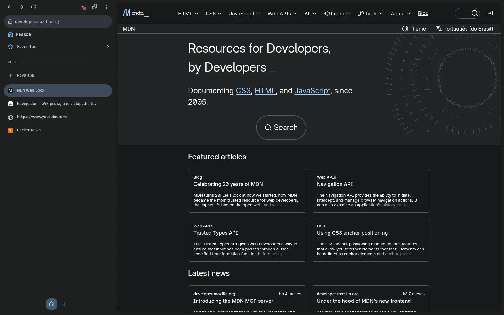
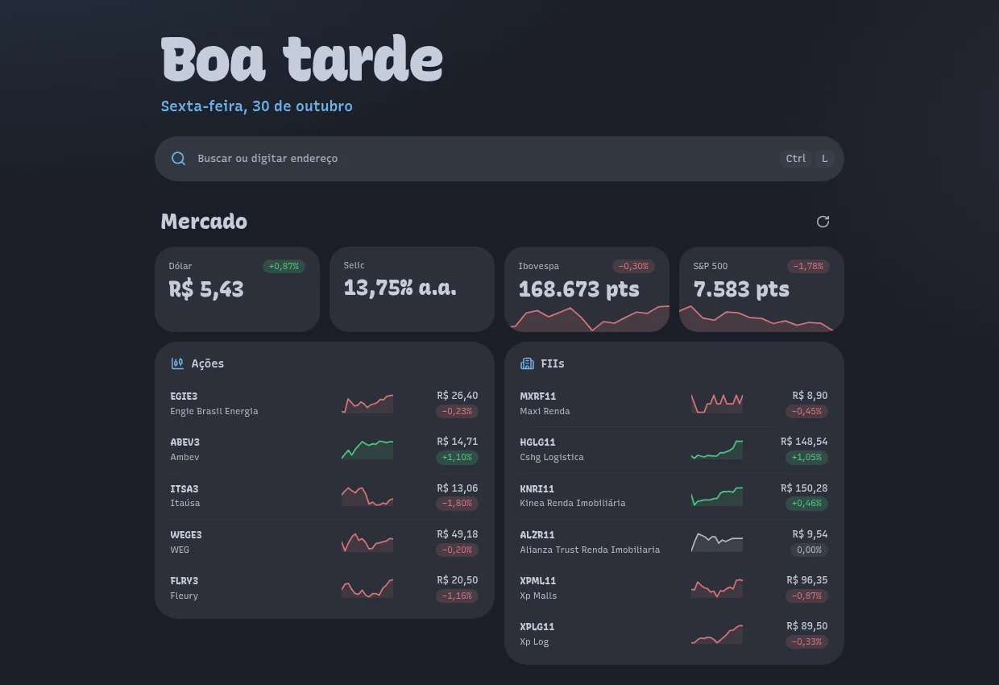

<div align="center">


# Log Pose

**Um navegador pessoal pra Linux, com barra lateral, espaços e cara de desktop.**

Feito sobre o [Helium](https://github.com/imputnet/helium) (Chromium sem Google), com a barra lateral no estilo do Arc, Material 3 e as cores do tema do sistema.


</div>



> [!NOTE]
> O Log Pose ainda está em desenvolvimento (0.x). Feito e compilado no Fedora; em outro Linux deve funcionar, sem garantia.

## Por que o Log Pose

O Chromium guarda abas numa faixa no topo, configurações em dois lugares e trata a janela como moldura. O Log Pose troca isso por uma barra lateral que organiza o dia: **espaços** pra separar trabalho e vida, **fixadas** pros sites de sempre, **hoje** pras abas que vêm e vão (e que se arquivam sozinhas). A página vira um cartão e o resto sai do caminho.

### A barra lateral

- **Espaços** com ícone, cor e sessão própria: cada espaço tem seus logins e cookies. Ctrl+Shift+← / → ou rolar de lado troca de espaço; cada um lembra a última aba.
- **Fixadas** em grade de cartões, com pastas. Um link aberto de uma fixada aparece num **Peek** por cima da página.
- **Hoje**: as abas do dia. Paradas dormem e as esquecidas são arquivadas, com Desfazer.
- **Favoritos**, downloads com anel de progresso, extensões fixadas e o endereço da aba atual.
- Renomear abas com duplo clique, Ctrl/Shift+clique pra marcar várias e fechar, mover ou fixar todas de uma vez.


## Destaques

<table>
<tr>
<td width="50%" valign="top">

**Spotlight**

Ctrl+T e Ctrl+L abrem uma busca única: no topo a busca, o site que você já visita completado e as sugestões do buscador; embaixo, Abas, Favoritos e Histórico em seções. Aliases como `a`, `f`, `h` e `yt` restringem a busca. A aba nova abre com a página inicial (saudação, tempo, mercado e notícias); é só começar a digitar pra buscar.


</td>
<td width="50%" valign="top">

**Barra que recolhe com mola**

Ctrl+Shift+S recolhe a barra e a página ocupa a janela. Encostar o mouse na borda traz a barra de volta com efeito de mola, empurrando a página.


</td>
</tr>
<tr>
<td width="50%" valign="top">

**Cobrinha de carregamento**

Enquanto a página carrega, um traço na cor do tema corre pela borda do cartão e fecha a volta quando termina.


</td>
<td width="50%" valign="top">

**Várias abas de uma vez**

Ctrl+clique e Shift+clique marcam abas; o menu vale pra todas: fechar, mover de espaço, juntar numa ilha, guardar num grupo, fixar, copiar os links.


</td>
</tr>
</table>

**Configurações num lugar só.** As opções do Log Pose e as do Chromium que fazem sentido estão na mesma página, com busca e navegação. As telas grandes (senhas, permissões de cada site) abrem a página do Chromium e voltam com Esc.


## Também

- **Privacidade do Helium**: sem serviços do Google, uBlock Origin embutido, ruído contra fingerprinting, Global Privacy Control e só HTTPS.
- **Abas divididas**: arraste uma aba da barra pra cima da página pra dividir à esquerda, à direita, em cima ou embaixo, abrir em nova janela ou levar pra outra janela do Log Pose. Cada metade tem botões pra arrastar, separar e fechar.
- **Ilhas**: botão direito numa aba, "Nova ilha", e as abas ficam juntas na lista com uma cor; nome e cor se troca no cabeçalho. Fechou as abas, a ilha some.
- **Grupos**: abas salvas num grupo recolhível na barra, que voltam ao reabrir. "Novo grupo" no menu da aba cria na hora; nome, cor e ícone se trocam no cabeçalho.
- **Mini player**: o que toca em outra aba aparece no pé da barra, com tocar/pausar, próxima e picture-in-picture.
- **Nova aba** com saudação, tempo, atalhos, mercado (indicadores, ações e FIIs) e notícias.
- **Tema do sistema**: segue as cores do denden e a transparência do material, no claro e no escuro.
- **Janela pequena**: links vindos de outros apps abrem numa janela compacta; "Abrir no Log Pose" leva pra janela principal.
- **Volta de onde parou**: abas, espaços e nomes de aba voltam ao reabrir, até depois de uma falha.
- **Atalhos configuráveis**, procurar na página num cartão, zoom em chip no endereço, informações do site pelo cadeado, captura de tela, QR code.
- **Funciona com o 1Password**, Widevine (streaming) e PWAs.



## Atalhos

| Atalho | O que faz |
|---|---|
| Ctrl+T | Spotlight pra nova aba |
| Ctrl+L | Buscar ou trocar o endereço da aba |
| Ctrl+Shift+S | Recolher ou fixar a barra lateral |
| Ctrl+Shift+← / → | Espaço anterior / próximo |
| Ctrl+D | Fixar ou desafixar a aba |
| Ctrl+Shift+D | Dividir a tela com a aba anterior |
| Ctrl+Shift+C | Copiar o link da aba |
| Ctrl+Tab | Abas recentes |
| Ctrl+, | Configurações |

Todos (menos Ctrl+Tab) mudam em Configurações → Atalhos.

## Instalar

Precisa de Linux x86_64, `zstd` e `pkexec` (polkit). Baixe a [release mais nova](https://github.com/AdolfoCarneiro/logpose/releases/latest) e rode o instalador:

```bash
curl -s https://api.github.com/repos/AdolfoCarneiro/logpose/releases/latest \
  | grep -o 'https://[^"]*x86_64\.tar\.zst' | head -1 | xargs curl -LO
tar -I zstd -xf logpose-*-x86_64.tar.zst
logpose-*-x86_64/install.sh
```

O Log Pose vai pra `/opt/logpose` (do root, como o 1Password pede) e ganha o comando `logpose`, o atalho no menu de apps e o `logpose-update`.

**Atualizar:** `logpose-update`. A versão nova é instalada ao lado da aberta e a barra lateral avisa *Atualização instalada · Reiniciar*.

## Compilar

O Log Pose é um conjunto de patches sobre o Helium (`patches/logpose/`) e a barra lateral como extensão de componente (`logpose/sidebar/`). Tudo compila na máquina, num container Docker (as dependências do Chromium não vão pro Fedora):

```bash
logpose/bin/logpose-build setup     # uma vez: baixa o Chromium, aplica os patches e configura (horas)
logpose/bin/logpose-build           # depois de mexer: recompila só o que mudou
logpose/bin/logpose-run             # abre o build
logpose/bin/logpose-release         # compila, empacota e publica a release no GitHub
```

Detalhes em [`logpose/README.md`](logpose/README.md).

## Créditos

- [Helium](https://github.com/imputnet/helium) e [helium-linux](https://github.com/imputnet/helium-linux), da imput, de onde este repositório é um fork.
- [ungoogled-chromium](https://github.com/ungoogled-software/ungoogled-chromium) e o [Chromium](https://www.chromium.org/).
- [Ranga](https://github.com/taigakilla/ranga), do taigakilla, de onde o Log Pose é um fork: a barra lateral, os espaços e quase toda a interface vêm de lá.
- O nome vem do Log Pose, a bússola da Grand Line em *One Piece*.

Licença GPL-3.0, como o Helium. Ver [LICENSE](LICENSE) e [LICENSE.ungoogled_chromium](LICENSE.ungoogled_chromium).
